<a id="top"></a>

<p align="center">
  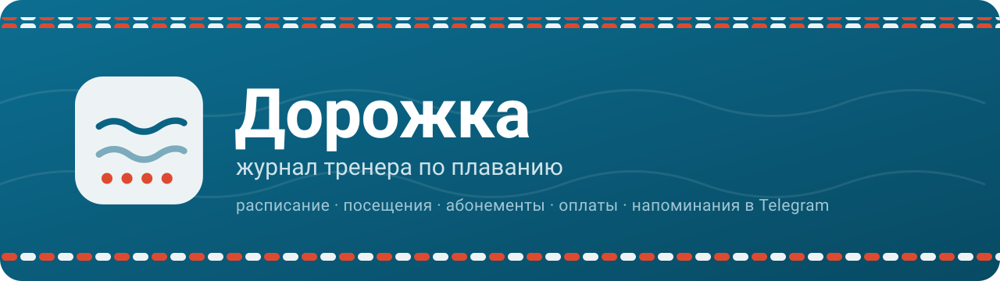
</p>

<p align="center">
  <b>Журнал тренера по плаванию.</b> В нём расписание, посещения, абонементы и оплаты с чеками. Напоминания о занятиях приходят тренеру в Telegram.
</p>

<p align="center">
  <a href="https://dorozhka.vercel.app"></a>
  
  
  
  
  
</p>

<p align="center">
  <a href="https://dorozhka.vercel.app"><b>Открыть сервис</b></a> ·
  <a href="#возможности">Возможности</a> ·
  <a href="#скриншоты">Скриншоты</a> ·
  <a href="#telegram-бот">Telegram-бот</a> ·
  <a href="#архитектура">Архитектура</a> ·
  <a href="#быстрый-старт">Быстрый старт</a> ·
  <a href="#дорожная-карта">Дорожная карта</a>
</p>

<picture>
  <source media="(prefers-color-scheme: dark)" srcset="docs/screenshots/today-dark.png">
  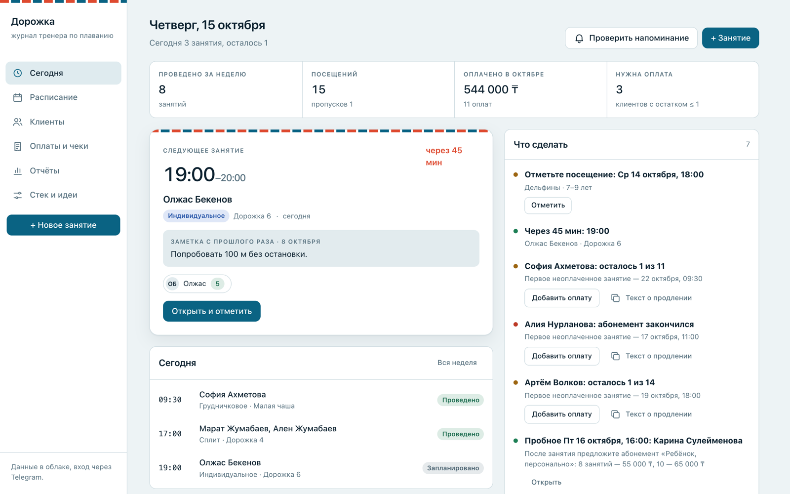
</picture>

<details>
<summary><b>Содержание</b></summary>

- [Зачем это](#зачем-это)
- [Возможности](#возможности)
- [Скриншоты](#скриншоты)
- [Telegram-бот](#telegram-бот)
- [Правила учёта](#правила-учёта)
- [Архитектура](#архитектура)
- [Безопасность](#безопасность)
- [Стек](#стек)
- [Быстрый старт](#быстрый-старт)
- [Разработка и выкладка](#разработка-и-выкладка)
- [Структура проекта](#структура-проекта)
- [Дорожная карта](#дорожная-карта)
- [Вопросы и ответы](#вопросы-и-ответы)
- [Благодарности](#благодарности)

</details>

## Зачем это

| Было | Стало |
|---|---|
| Расписание в тетради, оплаты в переписке, остаток занятий — в голове | Одно место: кто когда приходит, сколько занятий оплачено и сколько осталось |
| «Сколько у Тимура осталось?» — пересчитывать вручную | Остаток считается сам после каждой отметки, а должники видны на первом экране |
| Можно забыть занятие или не отметить пропуск | Бот напоминает до занятия и присылает кнопки отметки после него |

Любой тренер регистрируется через Telegram и ведёт свой отдельный журнал: чужих клиентов и оплат он не видит. Клиенты не видят ничего: бот пишет только тренеру.

## Возможности

- 📅 **Расписание по дням и неделям.** Типы: грудничковое, индивидуальное, сплит, мини-группа, групповое. Есть пробные занятия и отработки. В карточке клиента задаётся число тренировок и дни недели: у каждого дня своё время. Тренировки встают в расписание поровну на каждую неделю и заканчиваются на последней, без продления. Кнопка «Подобрать свободное время» предлагает готовые наборы дней и времени, свободные на всех датах абонемента с учётом рабочих часов и перерыва 10 минут; варианты копируются клиенту одним текстом.
- ✅ **Посещения по каждому человеку.** Отметки «Был», «Не предупредил», «Предупредил» — в сервисе или прямо из Telegram.
- 🎟️ **Абонементы и остаток.** Пакеты на 1, 8 и 10 занятий по вашему прайсу. Сервис показывает, сколько занятий прошло и сколько осталось, и когда закончится оплата. Сроков у абонементов нет.
- 💳 **Оплаты и чеки.** Оплата привязывается к номеру телефона клиента. Фото чека Kaspi читается на устройстве: сервис сам заполняет сумму, дату, телефон и тариф. Можно оплатить за двоих (сплит, двое детей из одной семьи).
- 📝 **Журнал тренировок.** К каждому занятию — как оно прошло и заметка к следующему. Заметка сама показывается перед следующим занятием, в том числе в напоминании бота.
- 🔔 **Напоминания тренеру в Telegram.** Утренняя сводка, напоминание до занятия, кнопки отметки после него, вечерний контроль неотмеченных.
- ⏸️ **Пауза клиента.** На время болезни или отъезда: занятия не списываются, место в группе сохраняется.
- 🏖️ **Отпуск тренера.** Все занятия за период отменяются без списания, а для клиентов готов текст, который можно разослать.
- 📈 **Отчёты и доход.** Посещаемость по неделям и типам, доход по месяцам, средний чек, новые клиенты. Таблицы копируются в Excel одной кнопкой.
- 📱 **Телефон и ноутбук.** Устанавливается на экран телефона как приложение. Тема светлая или тёмная, как в телефоне.

<sub>[↑ наверх](#top)</sub>

## Скриншоты

| Неделя | Отметка посещения |
|---|---|
| 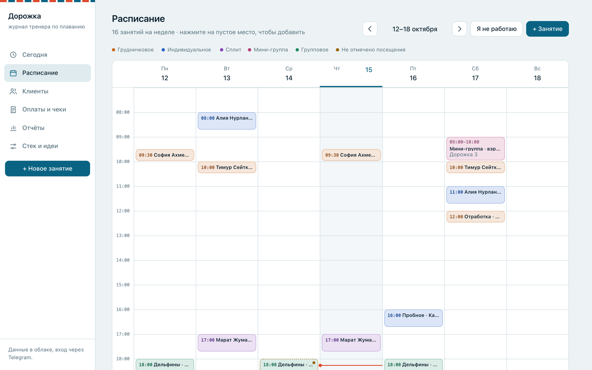 | 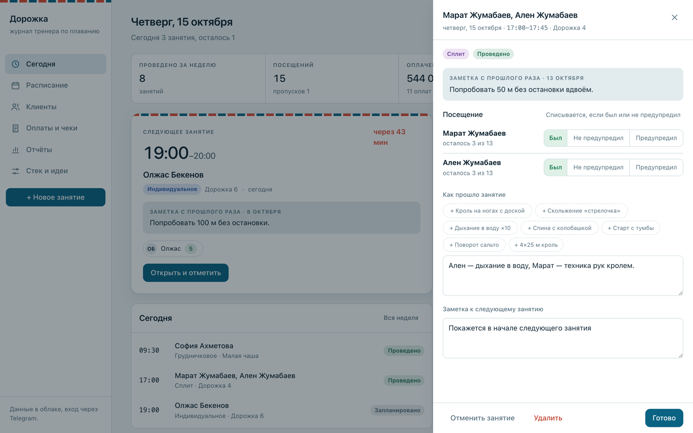 |
| **Карточка клиента** | **Оплаты и чеки** |
| 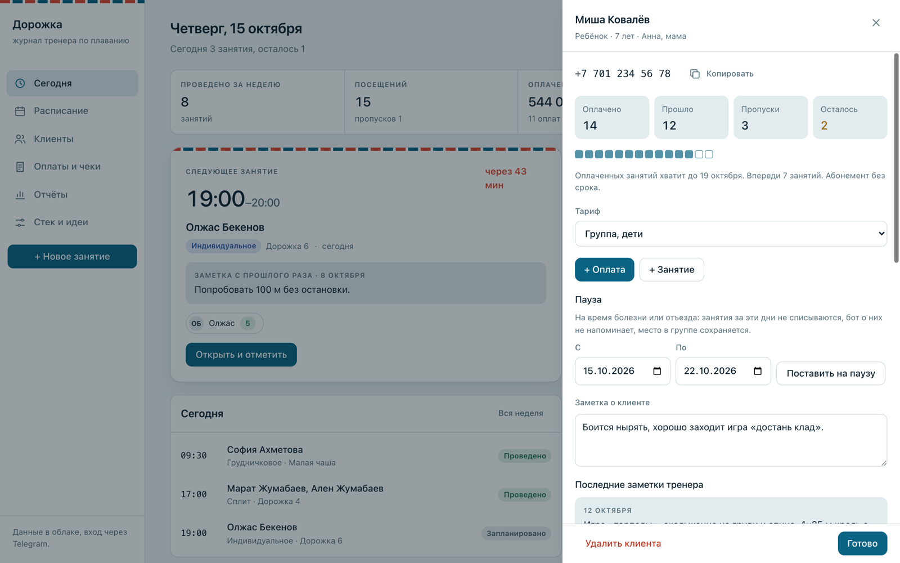 | 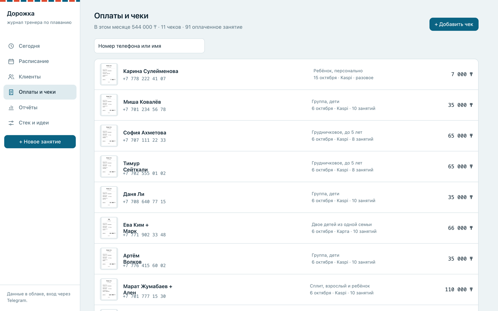 |

<p align="center">
  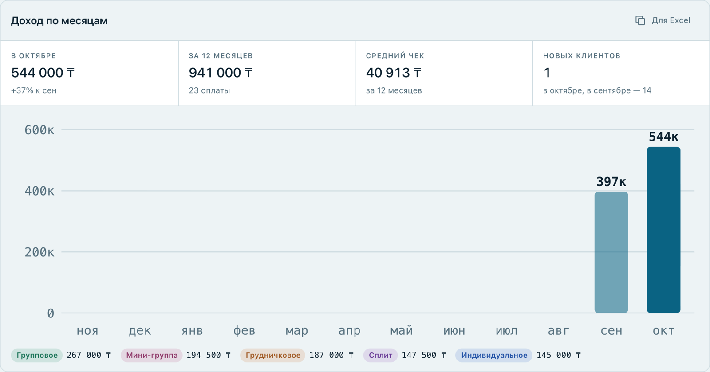
</p>

**На телефоне**

<p align="center">
  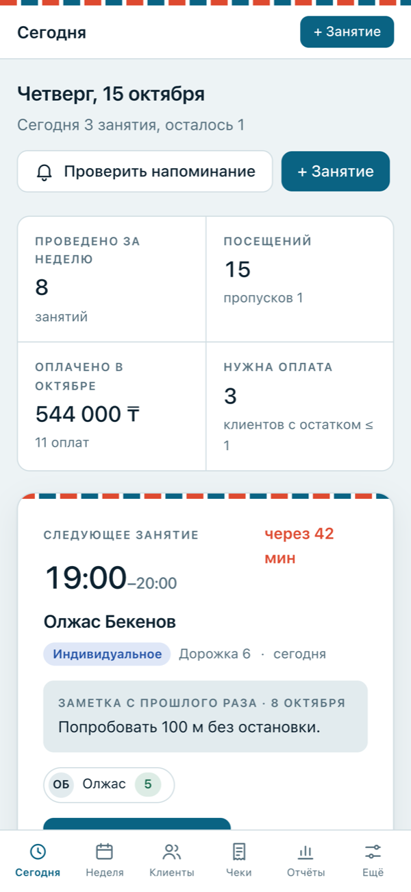
  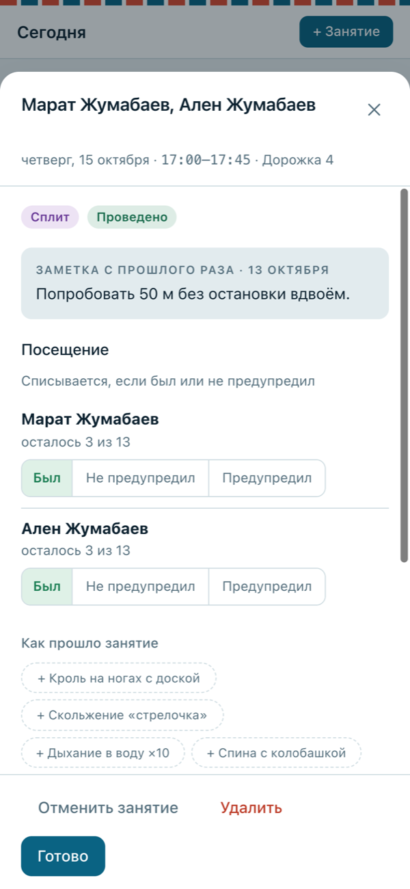
  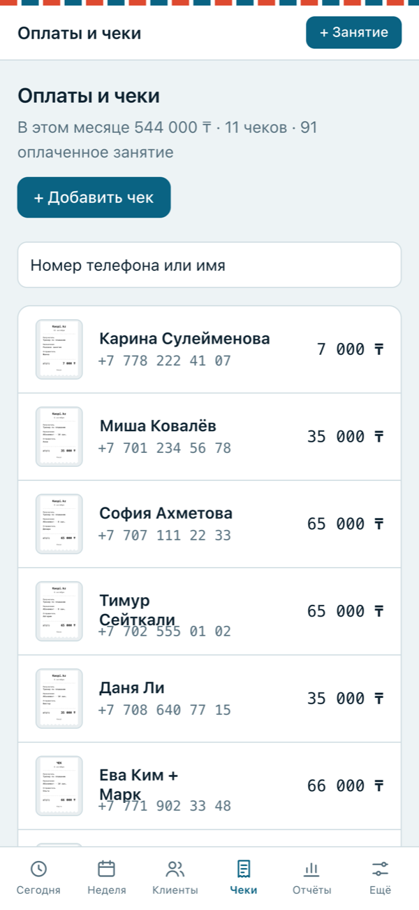
  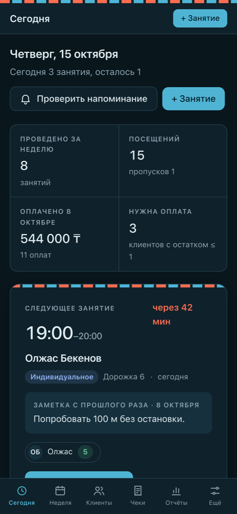
</p>

<sub>На скриншотах — демо-данные с выдуманными клиентами.</sub>

<sub>[↑ наверх](#top)</sub>

## Telegram-бот

<table>
<tr>
<td width="48%" valign="top">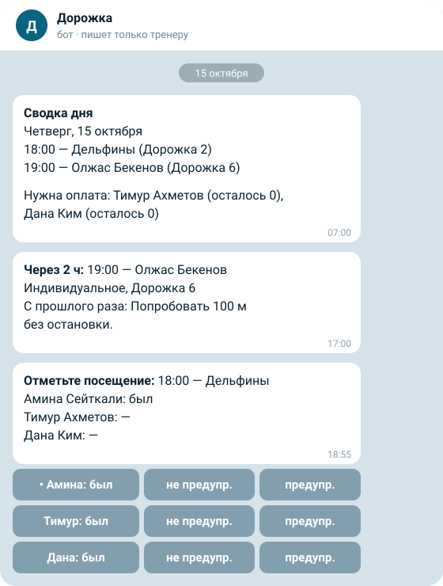</td>
<td valign="top">

Бот пишет **только тренеру** и никогда не пишет клиентам.

| Когда | Что присылает |
|---|---|
| 07:00 | Сводка дня: кто придёт, кому нужна оплата |
| 20-е число, 09:00 | Чеки за месяц: список оплат с 20-го прошлого месяца по 19-е, сумма и фото чеков альбомами. После отправки фото удаляются из сервиса (оплаты остаются), чтобы данные не росли |
| За 30 мин, 2 ч или день | Напоминание о занятии и заметка с прошлого раза |
| Через 10 мин после конца | Кнопки «был / не предупр. / предупр.» по каждому |
| 21:00 | Список занятий, которые остались не отмеченными |
| Отпуск тренера | Только запросы посещаемости |

Нажатие кнопки сразу сохраняется в сервисе и пересчитывает остаток.

**Команды:** `/today` — занятия на сегодня, `/next` — ближайшее занятие, `/receipts` — чеки с 20-го числа по сегодня.

**Вход в сервис** тоже через бота, без паролей и писем:

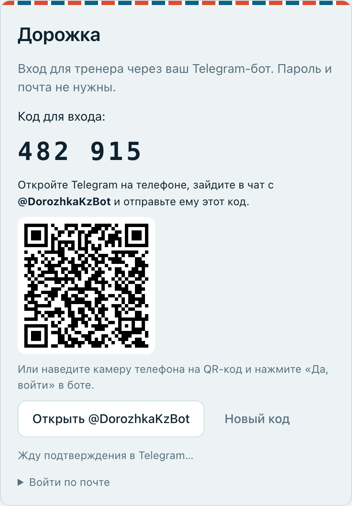

</td>
</tr>
</table>

<sub>[↑ наверх](#top)</sub>

## Правила учёта

**Типы занятий**

| Тип | Длительность по умолчанию | Состав |
|---|---|---|
| Грудничковое | 30 мин | малыш с родителем |
| Индивидуальное | 45 мин | 1 человек |
| Сплит | 45 мин | пара: один клиент на сплит или двое, всегда считается как 2 человека |
| Мини-группа | 45 мин | от 1 человека, без ограничения |
| Групповое | 45 мин | от 1 человека, без ограничения |

**Что списывается с абонемента**

| Ситуация | Списывается |
|---|---|
| Был | да |
| Не предупредил | да (можно выключить в настройках) |
| Предупредил | нет; если не пришёл никто из занятия, в конец расписания сама добавляется отработка (кроме групп) |
| Пробное занятие | никогда: оплачивается отдельно или бесплатно |
| Отработка | как обычное занятие |
| Клиент на паузе | нет; отметка, сделанная до паузы, остаётся |
| Отпуск тренера | занятия отменяются без списания |

<sub>[↑ наверх](#top)</sub>

## Архитектура

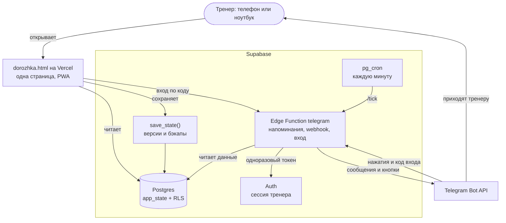

- **Данные — один JSON-документ на тренера** в таблице `app_state`: клиенты, группы, занятия, оплаты, прайс, настройки. Каждое сохранение проверяет номер версии. Если данные успели изменить с другого устройства, сервис покажет свежую версию и не затрёт её.
- **Логика напоминаний общая** (`shared/schedule.mjs`): её используют и облачная функция, и сервер на ноутбуке. Время считается в часовом поясе тренера, по умолчанию Asia/Almaty.
- **Каждое сообщение отправляется один раз.** Перед отправкой функция записывает его ключ в `sent_reminders`, поэтому даже два одновременных запуска не пришлют дубль.

<details>
<summary><b>Как работает вход через бота</b></summary>

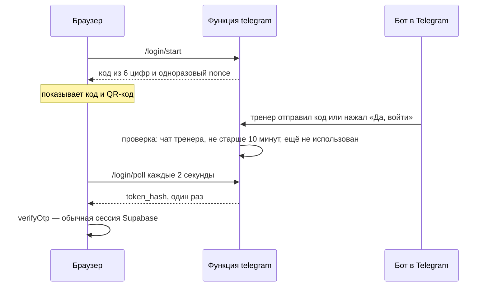

</details>

<sub>[↑ наверх](#top)</sub>

## Безопасность

| Кто | Что может |
|---|---|
| Любой в интернете | Открыть страницу входа и запросить код: не больше 6 раз за 10 минут с одного адреса |
| Тренер после входа | Читать свою запись `app_state` (RLS) и сохранять через `save_state` с проверкой версии |
| Чужой Telegram-чат | Ничего: бот отвечает и принимает нажатия только из чата тренера |
| Функция `telegram` | Работать с токеном бота, отправлять сообщения, выдавать вход |
| pg_cron | Вызывать `/tick` с секретом, который хранится только в базе |

- Регистрация закрыта: войти может только тренер.
- Токен бота лежит в закрытой таблице, к которой у браузера нет доступа.
- У API-ролей нет лишних прав: даже `TRUNCATE` отозван.
- Скрипты с CDN подключаются с хэшем целостности (SRI). Сайт отдаётся с заголовками HSTS, `X-Frame-Options` и `Permissions-Policy`.
- Раз в день сохраняется резервная копия данных, копии хранятся 30 дней.

## Стек

| Слой | Что | Почему |
|---|---|---|
| Интерфейс | Один HTML-файл, чистый JS, CSS-переменные | Нечего собирать, легко править, работает как PWA |
| Данные | Supabase Postgres, RLS, RPC `save_state` | Одна «тетрадь» тренера, защита от перезаписи, бэкапы |
| Фон | pg_cron и Edge Function (Deno) | Напоминания приходят, даже когда сайт закрыт |
| Бот | Telegram Bot API, webhook | Тренер и так в Telegram; кнопки работают сразу |
| Хостинг | Vercel, статический сайт | HTTPS и заголовки безопасности бесплатно |
| Чеки | tesseract.js на устройстве | Фото чека не уходит на сервер |
| Локальный режим | Node 24, встроенный `node:sqlite` | Работает на ноутбуке без облака и без зависимостей |

<sub>[↑ наверх](#top)</sub>

## Быстрый старт

**Тренеру**

1. Откройте https://dorozhka.vercel.app и нажмите **«Войти через Telegram»**.
2. Отправьте боту код с экрана или наведите камеру телефона на QR-код.
3. Добавьте сервис на экран телефона:
   - iPhone: Safari → «Поделиться» → «На экран „Домой“»;
   - Android: Chrome → меню → «Добавить на главный экран».

**Посмотреть демо на своём компьютере**

```bash
git clone https://github.com/4ikonya/dorozhka.git
cd dorozhka
python3 -m http.server 8000
```

Откройте http://localhost:8000/dorozhka.html. Сервис откроется с выдуманными клиентами, данные сохранятся только в этом браузере.

<sub>[↑ наверх](#top)</sub>

## Разработка и выкладка

```bash
npm install                  # Supabase CLI и Vercel CLI
node cloud/build.mjs         # собирает сайт в cloud/web и копирует shared/ в функцию
npx supabase functions deploy telegram --no-verify-jwt --workdir cloud
npx vercel deploy --prod --yes --cwd cloud/web
```

**Миграции.** Каждую новую миграцию применяйте так:

```bash
npx supabase db query --linked --workdir cloud -f supabase/migrations/<файл>.sql
```

Затем запишите её версию в `supabase_migrations.schema_migrations`.

> [!IMPORTANT]
> В этом проекте Supabase новые таблицы не получают прав для API-ролей автоматически. Выдавайте нужные `grant` в каждой миграции.

**Локальный режим (без облака).** Данные хранятся в SQLite на ноутбуке, бот работает через `getUpdates`:

```bash
node server/server.mjs       # порт 4318
```

> [!WARNING]
> Не запускайте сервер на ноутбуке с тем же ботом, пока бот подключён к облаку: напоминания будут приходить дважды. Для проверок задавайте `DB_FILE` и `TELEGRAM_API`, чтобы сервер работал с тестовой базой и тестовым Telegram.

## Структура проекта

```
.
├── dorozhka.html                    # всё приложение: интерфейс, логика, стили
├── shared/schedule.mjs              # напоминания и кнопки посещаемости, общие для облака и ноутбука
├── server/
│   ├── server.mjs                   # локальный режим: SQLite + Telegram
│   └── export-state.mjs             # выгрузка данных с ноутбука в JSON
├── cloud/
│   ├── build.mjs                    # сборка сайта в cloud/web
│   ├── config.json                  # адрес Supabase и публичный anon-ключ
│   └── supabase/
│       ├── config.toml              # вход, закрытая регистрация, функция без JWT
│       ├── migrations/              # таблицы, RLS, save_state, cron, вход через бота
│       └── functions/telegram/      # напоминания, webhook бота, вход
└── docs/                            # баннер, иллюстрации и скриншоты для README
```

<sub>[↑ наверх](#top)</sub>

## Дорожная карта

**Готово**

- [x] Расписание по дням и неделям, пять типов занятий, пробные и отработки
- [x] Число тренировок в карточке клиента, поровну на неделю, без продления
- [x] Своё время для каждого дня и подбор свободного времени по рабочим часам
- [x] Пропуск с предупреждением сам продлевает расписание на одну отработку
- [x] Регистрация любого тренера через Telegram, у каждого свой отдельный журнал
- [x] Свои тарифы в прайсе, новый журнал начинается с пустых цен
- [x] Посещения по каждому человеку и правила списания
- [x] Абонементы, остаток, долги, «оплаты хватит до…»
- [x] Оплаты по номеру телефона, фото чеков, чтение чека Kaspi
- [x] Журнал тренировок и заметки к следующему занятию
- [x] Напоминания и кнопки посещаемости в Telegram
- [x] Пауза клиента и отпуск тренера
- [x] Отчёты и доход по месяцам
- [x] Облако, вход через Telegram-бота, бэкапы

**Дальше**

- [ ] Лист ожидания: кто хочет в группу, если она уже набрана
- [ ] Удаление и архив групп
- [ ] Перенос занятия перетаскиванием в расписании
- [ ] Навыки ребёнка и отчёт-открытка для родителей
- [ ] Секундомер на 25/50 м и график личных рекордов
- [ ] PNG-иконки, чтобы сервис устанавливался на iPhone с красивой иконкой
- [ ] Привязка бота только по одноразовой ссылке при переподключении
- [ ] Content-Security-Policy для сайта
- [ ] Подтверждение при закрытии недозаполненной формы, год в датах старых оплат

## Вопросы и ответы

<details>
<summary><b>Почему всё в одном HTML-файле?</b></summary>

Сервис нужен одному человеку, и его должно быть легко поправить. Без сборщика и фреймворка нечего обновлять и нечему ломаться. Один и тот же файл работает в облаке, на ноутбуке и как демо.
</details>

<details>
<summary><b>Что будет, если я изменю данные с телефона и с ноутбука одновременно?</b></summary>

Каждое сохранение проверяет номер версии. Второе устройство не затрёт изменения первого: оно получит свежие данные и покажет их.
</details>

<details>
<summary><b>На компьютере ссылка на бота не открывается</b></summary>

Значит, на компьютере не установлен Telegram. Отправьте боту 6-значный код с телефона или наведите камеру телефона на QR-код. Компьютер войдёт сам.
</details>

<details>
<summary><b>Где резервные копии?</b></summary>

При первом сохранении за день прошлая версия данных копируется в таблицу `app_state_backups`. Копии хранятся 30 дней.
</details>

<details>
<summary><b>Можно ли подключить второго тренера?</b></summary>

Да. На сайте нажмите «Войти или создать журнал» и подтвердите в боте @DorozhkaKzBot «Да, создать журнал». Каждый тренер получает свой журнал, бот общий и различает тренеров по их чату.
</details>

## Благодарности

- [Supabase](https://supabase.com) — база, вход, функции и cron
- [Vercel](https://vercel.com) — хостинг сайта
- [tesseract.js](https://github.com/naptha/tesseract.js) — чтение чеков на устройстве
- [qrcode-generator](https://github.com/kazuhikoarase/qrcode-generator) — QR-код для входа
- [Telegram Bot API](https://core.telegram.org/bots/api)
- Структура этого README — по мотивам [awesome-readme](https://github.com/matiassingers/awesome-readme)

<p align="center"><sub>Закрытый проект для одного тренера. Лицензия не выбрана.</sub></p>
